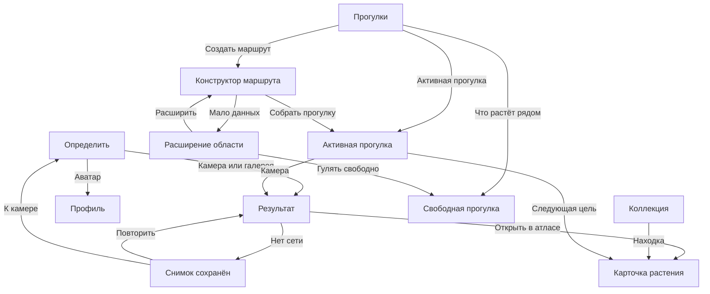

# Design-to-development handoff v2.0

Документ для агента, который будет реализовывать утверждённый редизайн в Compose Multiplatform. Это спецификация поведения и компонентов, не разрешение менять продуктовые сценарии.

## 1. Приоритет источников

При расхождении материалов использовать такой порядок:

1. [DECISION.md](../DECISION.md) — токены и формула гибрида.
2. [README итерации 2](./README.md) — состав блоков, нормативные строки и состояния.
3. Мокапы итерации 2 — композиция и визуальный вес.
4. [README итерации 1](../README.md) — общие принципы и исходные варианты.

Текст, нарисованный генератором внутри PNG, не является данными приложения. Любые названия рецептов, исторические утверждения, свойства и источники подставляются из API/БД.

## 2. Навигационная модель

### Нижняя навигация

Фиксированный порядок:

1. `Определить` — домашний camera-first экран.
2. `Прогулки` — хаб прогулок.
3. `Коллекция` — полевой журнал находок.

Профиль не является табом и открывается через маленький аватар в шапке. Возврат из профиля приводит на экран, с которого он был открыт.

### Разрыв с текущим клиентом

В текущем Android shell третий таб — `Tab.PROFILE`, а его содержимое реализовано через `HistoryRoute`. При реализации v2 требуется разделить понятия:

- `COLLECTION` становится третьим табом и сохраняет текущую историю находок;
- собственный профиль становится отдельным destination;
- существующие переходы в чужой профиль сохраняются отдельным destination;
- восстановление активной прогулки после process death остаётся обязательным.

## 3. Общий каркас экранов

| Параметр | Значение |
|---|---:|
| Базовая сетка | 4 dp |
| Горизонтальный край | 16 dp |
| Основные вертикальные интервалы | 8 / 12 / 16 / 20 / 28 dp |
| Минимальный тач-таргет | 48 × 48 dp |
| Основная кнопка | 52–56 dp высотой |
| Радиус строки | 18 dp |
| Радиус карточки | 24 dp |
| Радиус photo hero | 28–32 dp |
| Нижняя навигация | 72 dp + system inset |

- Все плотные экраны вертикально прокручиваются; фиксированная высота не должна обрезать текст.
- Bottom bar показывается только на трёх корневых табах.
- Detail, builder, active walk и offline state открываются поверх табов и имеют системный Back.
- Системные inset учитываются на Android и iOS. Фон Paper продолжается под inset, интерактивные элементы — нет.
- Одна секция содержит не более одного визуально главного CTA.

## 4. Спецификация экранов

### 4.1. Карточка растения

Композиция: дисциплина A, цвета и мягкость B.

- `PageHeader`: 56 dp без system inset; Back 48 dp.
- `PlantIdentityHero`: высота по контенту, ориентир 232–280 dp. Гравюра занимает до 44% ширины, имя — оставшуюся часть.
- `SafetyBanner`: сразу после hero, не сворачивается, Danger-фон/подложка, иконка + текст. Минимальная высота 64 dp.
- `VerdictCard`: 2–3 строки, не больше 240 символов в кратком состоянии.
- `UseActionRow`: три равных элемента при ширине ≥360 dp; при увеличенном шрифте перенос в вертикальный список.
- `CompoundChips`: переносимые чипы, не горизонтальный скролл.
- `HarvestRow`: часть растения и сезон читаются одной строкой; при нехватке места — две строки.
- `RecipeCard`: источник и год всегда видимы без открытия карточки.
- `SourcesRow`: закрытый accordion; раскрытие не меняет порядок остальных секций.

Прокрутка: события просмотра секций считаются только после видимости ≥50% в течение ≥800 мс.

### 4.2. Коллекция

- `PageHeader` + счётчик находок.
- `SearchField`: 52 dp, очистка запроса имеет отдельный target 48 dp.
- `FilterChips`: горизонтальный скролл без обрезанного активного чипа при входе.
- `FindingGrid`: две колонки, gap 12 dp, изображения пользователя с отношением сторон 4:3.
- `FindingCard`: имя максимум две строки; дата и место — максимум две строки, без многоточия у даты.
- Empty state взаимоисключающий с сеткой. Его присутствие в мокапе — демонстрация компонента, не финальное одновременное состояние.

Состояния: loading skeleton, content, search-no-results, empty-first-use, recoverable-error.

### 4.3. Профиль

- `ProfileHero`: аватар 88–96 dp; ник и уровень; статистика без соревновательного доминирования.
- `BadgeShelf`: горизонтальная полка, медальон 72–80 dp, подпись до двух строк, tier читается текстом.
- `FriendsRow`: аватары 40–44 dp; переход к друзьям отдельным target.
- `RatingRow`: обычная строка, не hero и не цветовой акцент.
- `PrivacyRow`: вся строка кликабельна; текущее значение обязательно текстом справа.

Лента не добавляется. Настройки приватности не прячутся внутри общего экрана настроек.

### 4.4. Конструктор маршрута

- Карта занимает весь доступный экран.
- `PageHeader` располагается на непрозрачной Paper-подложке или имеет гарантированный контраст.
- `RadiusOverlay`: круг — 2 dp Forest/Moss; зона — Leaf с низкой непрозрачностью; Lime-ручка имеет видимый диаметр 20–24 dp, но touch target 48 dp.
- Масштаб карты синхронизируется с радиусом так, чтобы круг целиком оставался в safe viewport над bottom sheet.
- `BuilderSheet`: ориентир 236–300 dp в обычном состоянии; высота по контенту при font scale.
- Изменение радиуса не запускает сетевой запрос на каждый pixel drag. Во время drag обновляется локальная геометрия, estimate запрашивается после debounce/end gesture.

Low-data state заменяет содержимое той же панели, не открывает отдельный системный dialog. Кнопка расширения меняет радиус до предложенного значения и повторяет estimate; «Гулять свободно» уводит в nearby/free mode.

### 4.5. Активная прогулка

- `WalkProgress`: компактный, под header.
- `NextTargetHero`: главное содержимое; фото 42–48% ширины, имя и дистанция справа либо под фото на узком экране.
- `WalkCameraAction`: 56 dp, остаётся доступным после hero. Не делать плавающей кнопкой поверх важного текста.
- `ParticipantsRow`: аватар + имя + вклад; счётчик не заменяется цветом.
- `TargetListCollapsed`: показывает прогресс и 4–5 миниатюр; раскрытие — отдельное состояние.
- `FinishWalk`: тихая destructive-outline строка внизу, с подтверждением только если есть риск потерять незавершённый прогресс.

Для велосипедного режима взаимодействия во время движения не проектируются: пользователь должен остановиться для камеры и изменения маршрута.

### 4.6. Ошибка определения / офлайн

- Сохранённый thumbnail обязателен: пользователь видит, что именно не потерялось.
- Состояние описывается как сохранение, а не как фатальная ошибка.
- Retry и возврат к камере доступны без удаления pending-находки.
- `SafetyBanner` для грибов остаётся full-width и не уходит под fold на типовом 390 × 844 dp viewport.
- Нельзя показывать кандидата, процент или «похожее растение», если сервер не вернул валидный результат.

## 5. Компонентный словарь

| Компонент | Экраны | Обязательные состояния |
|---|---|---|
| `PageHeader` | все detail | normal, long-title |
| `CameraHero` | Home | ready, permission-needed |
| `RewardBanner` | Home | visible, absent |
| `PlantShelfCard` | Home | normal, toxic, edible |
| `CandidateHero` | результат | corpus, external-only |
| `SafetyBanner` | результат, plant, offline | toxic, mushroom |
| `PlantIdentityHero` | plant | plate, no-plate fallback |
| `FindingCard` | collection | normal, pending-identification |
| `BadgeMedallion` | profile | place/biotope × tier |
| `NearbyBiotopeCard` | walks | resolved, unresolved |
| `ActiveWalkCard` | walks | active, reconnecting |
| `ParkCard` | walks | distance-known, distance-unknown |
| `RouteRadiusPreview` | walks/builder | viable, low-data |
| `RouteBuilderSheet` | builder | estimating, viable, low-data, error |
| `NextTargetHero` | active walk | target, all-found |
| `BotanicalTabBar` | roots | identify/walks/collection active |

## 6. Ассеты и правила использования

- Таб-иконки: [assets/nav](./assets/nav). Мастер 512 px; отрисовка 24–28 dp без tint.
- Гравюры: [assets/plates](./assets/plates). Использовать `ContentScale.Fit`, никогда `Crop`. Фолбэк без гравюры обязателен.
- Фон камеры: [camera-hero-background.png](./assets/camera/camera-hero-background.png). Растянуть по ширине hero с сохранением пропорций; центр не перекрывать дополнительным изображением.
- Empty states: [assets/empty-states](./assets/empty-states). Текст и кнопка остаются нативными Compose-компонентами, не запекаются в PNG.
- Map reference: [walk-map-style-tile.png](./assets/map/walk-map-style-tile.png). Это референс стиля реальной карты, не тайл для бесконечного повторения и не слой управления.

## 7. Адаптация

| Условие | Правило |
|---|---|
| Ширина ≥360 dp | базовая композиция мокапов |
| Ширина 320–359 dp | уменьшить горизонтальный край до 12 dp; карточки не мельче target; при необходимости одна колонка коллекции |
| Font scale 1.15–1.30 | высота карточек по контенту; горизонтальные группы могут стать вертикальными |
| Длинные названия | максимум 2 строки в карточке, без уменьшения шрифта ниже токена |
| Landscape | detail остаётся скроллируемым; builder отдаёт карте больше ширины, sheet может стать боковой панелью |
| Offline | основное содержимое доступно из локального состояния; сеть не блокирует Back/камера/коллекцию |

## 8. Порядок реализации

1. Подключить токены и шрифты из DECISION.md.
2. Разделить `Collection` tab и `Profile` destination, сохранив историю и back stack.
3. Подключить новый nav asset set и `BotanicalTabBar`.
4. Собрать общие карточки и safety-компоненты.
5. Реализовать Home/Result/Plant/Collection/Profile.
6. Реализовать Walk hub/Builder/Active walk/Offline state.
7. Подключить `layout_version=2` и события из [ANALYTICS-MAP.md](./ANALYTICS-MAP.md).
8. Проверить Android и iOS на реальных размерах, font scale 1.3, offline и process restoration.

## 9. Definition of done для визуальной реализации

- Три корневых таба соответствуют утверждённой информационной архитектуре.
- Profile открывается через аватар и не подменяет Collection.
- Камера остаётся главным действием Home и доступна в активной прогулке.
- Plant safety появляется до любых применений и рецептов.
- Low-data builder предлагает расширение и свободную прогулку.
- Empty state коллекции не показывается одновременно с заполненной сеткой.
- Ни один пользовательский текст не запечён в PNG.
- Все основные действия имеют стабильный `element_id`.
- Переходы, active time, ошибки и глубина просмотра измеряются без фото, GPS, handle и текста запросов.
